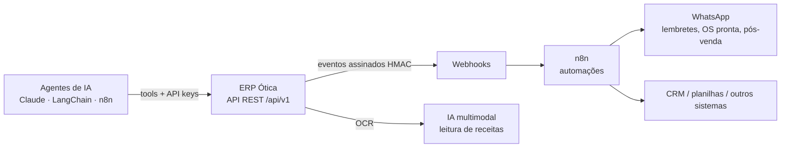
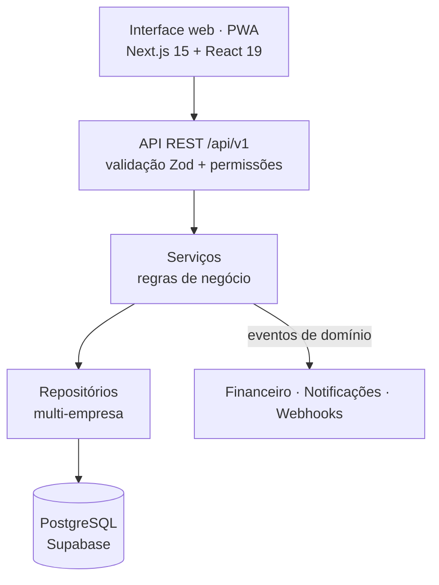

# ERP Ótica · OticaHub

**ERP web completo para óticas — da receita do cliente até o financeiro — construído do zero ao produto final com Inteligência Artificial.**

**[oticahub.com](https://oticahub.com)**

> 🔒 **O código-fonte é privado** porque o sistema está em operação em uma empresa. Este repositório apresenta o projeto: o problema, a solução, a arquitetura e como ele foi construído. Demonstração ao vivo sob pedido pelo [LinkedIn](https://www.linkedin.com/in/antonio-alex-silva-ferreira-65434a298/).

---

## O problema

Uma ótica trabalha com informação espalhada: receita do cliente em papel, venda em um sistema, ordem de serviço do laboratório em outro, estoque em planilha e financeiro no caderno. O resultado é retrabalho, erro de digitação de grau, venda sem baixa de estoque, cliente sem retorno e nenhuma visão real do negócio.

## A solução

Um ERP único, em nuvem, que conecta **toda a operação da ótica** — e conversa com outras ferramentas por API.

| Área | O que o sistema faz |
| --- | --- |
| 👤 **Clientes** | Cadastro com CPF validado, histórico consolidado, anexos e consentimento LGPD |
| 👓 **Receitas oftálmicas** | OD/OE com validação de dioptria, impressão, duplicação e **leitura automática da receita por IA (OCR)** |
| 🛒 **Vendas e orçamentos** | PDV com tratamentos, descontos, comissão, pagamentos e conversão de orçamento em venda |
| 🔧 **Ordem de serviço** | Fluxo de status do laboratório, QR Code, impressão A4 (via cliente e via loja) e envio por WhatsApp |
| 📦 **Estoque** | Entradas, saídas, ajustes e inventário com **baixa automática na venda** e alerta de estoque mínimo |
| 💰 **Financeiro** | Contas a pagar/receber, fluxo de caixa, DRE e comissões geradas automaticamente pelas vendas |
| 📈 **CRM e agenda** | Funil Kanban de leads, aniversários, pós-venda e agenda de exames, entregas e retornos |
| 📊 **Dashboard e relatórios** | Indicadores de vendas, produção e financeiro, relatórios em PDF, Excel e CSV |
| 🕶️ **Simulador 3D de lentes** | Visualização 3D para explicar ao cliente a diferença entre lentes |
| 🤖 **IA nativa** | Chat interno que responde com os dados reais da ótica, explica lentes e gera orçamentos |

## Integrações — API First

O sistema foi desenhado para **se conectar**, não para ser uma ilha:

- **Webhooks** com assinatura HMAC e reenvio automático: cada venda, OS pronta ou pagamento dispara um evento.
- **Integração com n8n**: os eventos viram automações — mensagem no WhatsApp quando a OS fica pronta, lembrete de retorno, pós-venda.
- **API para agentes de IA**: funções como `buscar_cliente` e `criar_venda` expostas para agentes (n8n, LangChain, Claude), com as mesmas permissões do usuário.
- **Swagger/OpenAPI** documentando todas as rotas.

## Arquitetura

- **Multi-empresa (multi-tenant)**: várias óticas no mesmo sistema, com os dados isolados por empresa.
- **Permissões por perfil (RBAC)**, login com JWT e renovação segura de sessão.
- **Eventos de domínio**: a venda gera automaticamente o financeiro, as comissões, as notificações e os webhooks, sem acoplamento entre módulos.
- **Segurança e LGPD**: auditoria de alterações, limite de requisições, exportação e anonimização de dados pessoais.
- **Qualidade**: testes automatizados (Vitest e Playwright) e esteira de CI.

**Stack:** Next.js 15 · React 19 · TypeScript · Prisma · PostgreSQL (Supabase) · Tailwind · Zod · TanStack Query · WebSocket · Docker · Vercel.

## Como foi construído — do zero ao final com IA

Não sou programador de formação. Sou estudante de **Engenharia de Produção** e construí este ERP **inteiramente com Inteligência Artificial**, do planejamento à operação:

1. **Planejamento como projeto de engenharia** — mapeei os processos da ótica e dividi o sistema em **22 módulos** com dependências, entregáveis e critérios de aceite.
2. **Ciclo padronizado por módulo** — cada módulo passou pelas mesmas 12 etapas (planejamento → banco → API → regras → telas → validações → testes → documentação → checklist → revisão). Um módulo só começava quando o anterior passava na revisão — **trabalho padronizado e controle de qualidade aplicados ao software**.
3. **IA como equipe de desenvolvimento** — eu definia o processo, as regras e os critérios; a IA escrevia o código; eu validava, testava e corrigia.
4. **Colocar no ar e operar** — deploy na Vercel + Supabase e uso diário em uma ótica real, com melhorias contínuas a partir do uso.

## Autor

**Antonio Alex Silva Ferreira** — estudante de Engenharia de Produção e Técnico em Óptica. Uso IA para resolver problemas reais de gestão, conectando ferramentas por API, MCP e n8n.

Veja também: **[Laboratório Óptico](https://github.com/alexferreiraindustrial-hue/laboratorio-optico)** — o sistema de produção do laboratório de montagem, com código aberto para consulta.

---

© 2026 Antonio Alex Silva Ferreira LTDA. Software proprietário — todos os direitos reservados.
